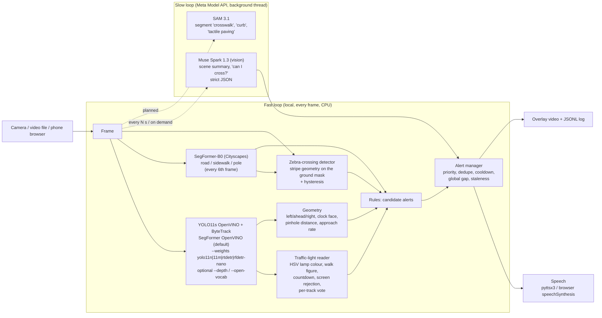

# StreetSense

**Real-time street-scene assistant for blind and low-vision pedestrians.**
A camera (phone, webcam, later Ray-Ban Meta glasses) watches the street. StreetSense announces the few things that matter, in short spoken phrases:

> "car approaching on your right" · "person ahead, 2 metres" · "pedestrian crossing here" · "pedestrian light is red" · "walk signal on, countdown running" · "careful, road ahead of you" · "pole ahead"

Built for the Meta Global AI Developer Hackathon (Oct 26 – Nov 4, 2026). Theme: *Build for Your World*. See [docs/HACKATHON.md](docs/HACKATHON.md).

## Architecture

Two loops. The fast local loop handles safety-critical alerts at camera rate on a CPU. The slow loop calls Meta models for reasoning the local models can't do.



| Module | Role |
|---|---|
| `streetsense/detector.py` | **YOLO11s** (COCO) via **OpenVINO by default** (auto-exports `models/yolo11s_openvino_model/`; falls back to PyTorch). Per-class conf (person 0.28). `--weights models/yolo11n.pt\|yolo11m.pt\|rtdetr-l.pt\|rfdetr-nano\|yolo26n.pt`. `ApproachTracker` flags growing boxes |
| `streetsense/rfdetr_detector.py` | Optional **RF-DETR Nano** (Apache-2.0) via `--weights rfdetr-nano`; COCO-91 / `class_name` mapping. Not default (CPU ~53 ms, no ByteTrack, pipeline ~13 FPS) |
| `streetsense/depth.py` | Optional **Depth Anything V2 Small** (Apache-2.0) via `--depth`; OpenVINO ~47 ms every N frames; metres calibrated to box-height priors. Not default |
| `streetsense/traffic_light.py` | Lamp colour from HSV. Orange means amber on vehicle heads and the "hand" on pedestrian heads. US white walk figure + countdown; EU tall red/green man silhouette; rejects bright screens; votes over a track; ranking prefers walk/red over sticky green |
| `streetsense/crosswalk.py` | Zebra stripes: bright, low-saturation, elongated, parallel bars on the road/sidewalk mask, with k-of-n hysteresis |
| `streetsense/open_vocab.py` | Optional YOLO-World slow loop (`--open-vocab`, conf 0.10) for bollard/scooter/kerb/pothole/… prompts (AGPL). Measured useful on Tomaszów/Mazatlán hazard clips |
| `streetsense/surface.py` | SegFormer-B0 Cityscapes via **OpenVINO by default** (auto-converts to `models/segformer_b0_cityscapes_openvino/`; PyTorch fallback). Underfoot road/sidewalk + pole-ahead |
| `streetsense/geometry.py` | Zones, clock-face direction, walking corridor, pinhole distance from class height priors (overridden by `--depth` when calibrated) |
| `streetsense/rules.py` | Perception to candidate alerts (one traffic light per frame, pedestrian heads first) |
| `streetsense/alerts.py` | What gets said and when (see below) |
| `streetsense/meta_api.py` | Muse Spark vision client (OpenAI-compatible, `MODEL_API_KEY`), JSON reply parsing, SAM 3.1 segmenter + Voice Transcribe |
| `streetsense/signal_distance.py` | Distance to signal heads and signs (pinhole from housing size, camera HFOV presets, optional depth fusion) and caution-only rules: far, off-to-the-side, or out-ranked walk/green heads become "unclear, wait". See [docs/SIGNAL_DISTANCE.md](docs/SIGNAL_DISTANCE.md) |
| `streetsense/meta_usage.py` | Token/SAM/voice cost ledger + hard budget cap (`STREETSENSE_META_BUDGET_USD`) |
| `streetsense/sam_fallback.py` | Cost-capped SAM 3.1 signal-box fallback (crossing context only; boxes only, never authorises crossing). See [docs/SAM_FALLBACK.md](docs/SAM_FALLBACK.md) |
| `docs/META.md` | How StreetSense uses each Meta model; measured latency, cost, crossing agreement |
| `streetsense/web.py` | Phone demo: the browser camera posts frames, alerts are spoken with `speechSynthesis`, and a "Can I cross?" button asks Muse Spark |
| `streetsense/cli.py` | `run` / `ask` / `serve` |

### Alert policy
- Priorities: CRITICAL (vehicle close or approaching in path) > WARNING (person or obstacle in path, pedestrian light at a crossing, road underfoot, pole) > NOTICE (crossing ahead, light state) > INFO.
- At most one phrase every 1.5 s. Only CRITICAL alerts can break that gap.
- The same *state* isn't repeated within 6 s (2.5 s for CRITICAL) unless its priority goes up.
- Pending alerts older than 2 s are dropped, because they no longer describe the scene.
- A light state is announced only after 3 agreeing frames (tracked **or** IoU-matched untracked). Countdown-only frames hold the last colour for ~1 s of flicker, then report countdown/uncertain — they never refresh a stale walk forever. Internal states like `countdown` never reach the alert layer for untracked heads.
- Unknown / unclear states are never announced as walk. When unsure the system says wait, never go.

Signal timing, confirmation fixes and the measured DC flicker tradeoff are documented
in [docs/SIGNAL_STABILITY.md](docs/SIGNAL_STABILITY.md), including a local trace/replay tool.

### Alert safety
Guarantees added after the Oct 2026 external review:

1. **No stale contradictory speech.** Light alerts share a pending family (`light:{kind}`) so walk/red replace each other; cooldown stays per `light:{kind}:{state}` so real transitions still speak. Pending speech is revalidated against current facts before emit.
2. **Signal selection by relevance.** Prefer central, larger, crosswalk-associated heads. Conflicting relevant walk+red → announce "crossing signals unclear, wait" instead of picking walk. A sticky vehicle-green head does not silence a real walk. Distance checks can only add caution: a walk/green head that is far (>40 m), more than 25° off-axis, or behind a nearer non-walk/unreadable head is announced as "wait"; the spoken line includes distance ("walk signal on, about 15 metres ahead").
3. **Speech keeps urgency.** The speaker accepts structured `Alert`s, expires stale queue items, lets CRITICAL evict lower-priority phrases, supports interruption, and reports delivery so a dropped phrase is not counted as spoken.
4. **Crossing answers have a contract.** Muse JSON must pass strict schema validation. Malformed / free-text replies become the fixed fallback *"I can't tell, please wait"*. Spoken go requires local walk **and** Muse yes; speech is rendered from validated fields only. Capture timestamps expire stale answers.
5. **Per-session web state.** Each browser gets its own Pipeline (tracker, votes, cooldowns) keyed by session cookie, with TTL and reset on camera restart. Models/config are shared.
6. **Open-vocab is rate-limited.** Empty success is not "not initialised"; errors back off; cached boxes expire.
7. **Truncation is honest.** Single-edge clips return no precise distance; rules still warn with "very close" from visible footprint.
8. **Demo `/ask` is gated.** Optional `STREETSENSE_DEMO_TOKEN`, per-session rate limit, and single-flight. Empty `/frame` bodies return HTTP 400 (not 500).

## Quick start

```bash
python3 -m venv .venv && . .venv/bin/activate
pip install torch torchvision --index-url https://download.pytorch.org/whl/cpu
pip install -e '.[dev,speech]'
mkdir -p models && python -c "from ultralytics import YOLO; YOLO('yolo11s.pt')" && mv yolo11s.pt models/
# OpenVINO IR is auto-exported on first run to models/yolo11s_openvino_model/
# Optional: yolo11n.pt / yolo11m.pt / rtdetr-l.pt / yolov8s-worldv2.pt for --open-vocab
scripts/get_samples.sh

# annotated video + alerts log (alerts timed in video seconds)
python -m streetsense run --source samples/tyumen_crossing.webm \
    --out outputs/tyumen.mp4 --alerts outputs/tyumen_alerts.jsonl --stats outputs/tyumen_stats.json

# webcam with spoken alerts
python -m streetsense run --source 0 --speak

# optional depth / open-vocab / RF-DETR
# python -m streetsense run --source samples/tyumen_crossing.webm --depth --no-vlm
# python -m streetsense run --source samples/tomaszow_scooter.ogv --open-vocab --no-vlm
# python -m streetsense run --source samples/tyumen_crossing.webm --weights rfdetr-nano --no-vlm

# phone demo (open http://<host>:8000; phone camera access needs HTTPS, e.g. a cloudflared/ngrok tunnel)
python -m streetsense serve --port 8000

# Meta Model API (after claiming the $150 credits)
export MODEL_API_KEY=...        # never commit it
python -m streetsense ask --image outputs/frames_tyumen/frame_00480.png --question "Can I cross now?"
```

With `MODEL_API_KEY` set, `run` and `serve` also send a frame to Muse Spark every 10 s in a background thread. The summary is drawn on the overlay; validated hazard phrases are also offered to `AlertManager` at INFO priority. Without a key the slow loop is skipped and nothing breaks.

For a public tunnel, set `STREETSENSE_DEMO_TOKEN` so `/ask` requires `X-Demo-Token`. See [docs/META.md](docs/META.md).

**Muse Wonder guide (opt in).** `python -m streetsense guide --source clip.webm --at 8 --question "Where is the crosswalk?"`,
or `STREETSENSE_WONDER=1` for the web "Guide me" button. Wonder plans over the last few seconds of local
facts, SAM 3.1 and the crossing check, and answers in 1 or 2 short sentences in about 4 to 7 s for 1 to 2 cents.
It can never authorise a crossing: that line always comes from the local plus Muse Spark fusion. See [docs/META.md](docs/META.md).

**Ray-Ban Meta (not yet run on glasses).** Glasses mode in the web app (`/glasses`) and
`python -m streetsense glasses-sim` use the glasses camera stream sizes and frame rates, short phrases and earcons.
`/v1/chat/completions` speaks the protocol of Meta's VisionClaw sample app, so it can use StreetSense as its gateway.
Status and the phone app still needed: [docs/RAYBAN.md](docs/RAYBAN.md).

**Walking navigation (opt in, simulated GPS).** `python -m streetsense walk-sim --plot` walks a real Washington DC
route from recorded OpenStreetMap data: it picks the route with signalised crossings and no stairs, gives clock-face
turns, previews each crossing (signals, sound, tactile paving, lanes), warns when you drift off route with an honest
GPS caveat, and at each kerb fuses the map's crossing direction with what the camera sees. Add `--ask-muse` for the
Muse Spark check. `guide --maps` gives Muse Wonder `plan_route`, `find_nearby` and `route_status`; Google place facts
come through Google's Maps Experience agent tools when `GOOGLE_MAPS_API_KEY` is set. Map data never authorises a
crossing. See [docs/MAPS.md](docs/MAPS.md).

Tests: `python -m pytest -q`

## Measured on the dev box (8 vCPU x86, no GPU, 27 Oct 2026)
Input resized to 1280×720, **YOLO11s + SegFormer both OpenVINO by default**, SegFormer every 6th frame, ByteTrack on.

| Clip | Pipeline FPS (overlay on / off, YOLO11s) | Detect ms (OV 11s) | Notes |
|---|---|---|---|
| Tyumen crossing (CC BY-SA, 1080p) | **~25–27 / ~40** | ~18–21 | Was ~33 FPS with 11n; still ≫15 FPS target |
| Washington DC pedestrian signal (CC BY, 1440×810) | **~29 / ~42** | ~19 | Walk@10.8 s and red@52.8 s still fire |
| Mexico City crossing (CC BY-SA, 720p) | (11n baseline 32.5 / 57.9) | — | See [docs/BENCHMARK.md](docs/BENCHMARK.md) §7 |

Vs the previous default (OV detector + **PyTorch** SegFormer): pipeline overlay-on was ~25 FPS; surface when-runs ~58–67 ms (amortised ~10 ms). OpenVINO SegFormer is ~3× faster per call; overlay blend also trimmed (~12 ms vs ~17 ms) via `cv2.copyTo`. First-run converts: YOLO IR ~2 s, SegFormer IR ~5 s (both gitignored under `models/`). `--backend torch` forces PyTorch for detector **and** surface; `--surface-backend` overrides surface alone.

Web `/frame` server p50 (Tyumen JPEG): all-OpenVINO **13.2 ms** vs all-torch **16.7 ms**.

**Accuracy has not been measured on a labelled StreetSense dataset.** What has been checked:
- The light classifier passes 9 hand-labelled real crops (`tests/fixtures`).
- SegFormer torch↔OpenVINO on 36 sampled frames: pixel agreement **0.996**, mIoU **0.967**, underfoot label match **100%** ([docs/BENCHMARK.md](docs/BENCHMARK.md) §6).
- DC walk@10.8 s and pedestrian red@52.8 s still fire with OpenVINO surface.
- **YOLO11s** is the default weights (hand recall 0.50→0.68 on a 14-frame sample; coco128 mAP50-95 0.50→0.57). YOLO11n / 11m / RT-DETR-l / YOLO26n via `--weights`. See [docs/BENCHMARK.md](docs/BENCHMARK.md) §7.
- Optional `--open-vocab` runs YOLO-World every 15 frames for non-COCO hazards (conf 0.10); hits scooters/bollards on new Wikimedia clips.
- Optional `--depth` (Depth Anything V2 Small, Apache-2.0, OpenVINO ~47 ms every 6th) keeps pipeline **~17 FPS**; absolute metres still prior-calibrated — not default.
- RF-DETR Nano selectable (`--weights rfdetr-nano`, Apache-2.0); fixed COCO-91 mapping; hand F1 0.78 but **~13 FPS** — not default.

`python -m pytest -q`: 172 tests passing.

Traffic-light detector comparison (11 detectors, reader replay, latency, licences) and the opt-in tiled pass `STREETSENSE_LIGHT_TILES=2x3`: [docs/DETECTORS.md](docs/DETECTORS.md).

## Known gaps
- Distances use class height priors and an assumed 70° HFOV (optionally calibrated via `--depth`). Absolute metres remain rough; Tyumen far cars still overestimate.
- Vehicle vs pedestrian signal heads can't be reliably told apart by shape alone. A head is called "pedestrian" on walk figure or EU tall red/green silhouette; ranking prefers position/relevance to the crossing ahead, and refuses walk when relevant heads conflict.
- Crosswalk detection is a heuristic. It fails on faded paint, heavy crowds, and night glare.
- Open-vocab scooter scores often 0.05–0.25; some angles (Katowice) miss at conf 0.10. Stairs/potholes largely unproven.
- Ultralytics YOLO / YOLO-World are AGPL-3.0. RF-DETR (Apache-2.0) and Depth Anything V2 Small (Apache-2.0) are optional escapes from AGPL for those stages.

## Licences of sample media
See `samples/README.md` (Wikimedia Commons, CC BY / CC BY-SA).
