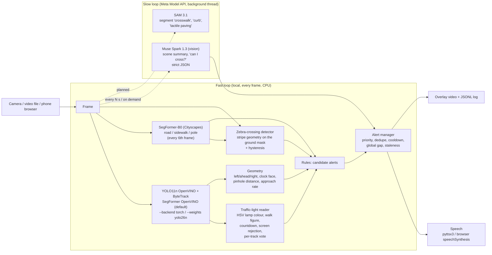

# StreetSense

**Real-time street-scene assistant for blind and low-vision pedestrians.**
A camera (phone, webcam, later Ray-Ban Meta glasses) watches the street. StreetSense announces the few things that matter, in short spoken phrases:

> "car approaching on your right" · "person ahead, 2 metres" · "pedestrian crossing here" · "pedestrian light is red" · "walk signal on, countdown running" · "careful, road ahead of you" · "pole ahead"

Built for the Meta Global AI Developer Hackathon (Oct 26 – Nov 4, 2026). Theme: *Build for Your World*. See [docs/HACKATHON.md](docs/HACKATHON.md).

## Architecture

Two loops. The fast local loop handles safety-critical alerts at camera rate on a CPU. The slow loop calls Meta models for reasoning the local models can't do.



| Module | Role |
|---|---|
| `streetsense/detector.py` | YOLO11n (COCO) via **OpenVINO by default** (auto-exports `models/yolo11n_openvino_model/`; falls back to PyTorch). `--backend torch` or `--weights models/yolo26n.pt`. `ApproachTracker` flags growing boxes |
| `streetsense/traffic_light.py` | Lamp colour from HSV. Orange means amber on vehicle heads and the "hand" on pedestrian heads. Detects the US white walk figure and countdown, rejects bright screens, and votes over a track |
| `streetsense/crosswalk.py` | Zebra stripes: bright, low-saturation, elongated, parallel bars on the road/sidewalk mask, with k-of-n hysteresis |
| `streetsense/surface.py` | SegFormer-B0 Cityscapes via **OpenVINO by default** (auto-converts to `models/segformer_b0_cityscapes_openvino/`; PyTorch fallback). Underfoot road/sidewalk + pole-ahead |
| `streetsense/geometry.py` | Zones, clock-face direction, walking corridor, pinhole distance from class height priors |
| `streetsense/rules.py` | Perception to candidate alerts (one traffic light per frame, pedestrian heads first) |
| `streetsense/alerts.py` | What gets said and when (see below) |
| `streetsense/meta_api.py` | Muse Spark vision client (OpenAI-compatible, `MODEL_API_KEY`), JSON reply parsing, SAM 3.1 box parser |
| `streetsense/web.py` | Phone demo: the browser camera posts frames, alerts are spoken with `speechSynthesis`, and a "Can I cross?" button asks Muse Spark |
| `streetsense/cli.py` | `run` / `ask` / `serve` |

### Alert policy
- Priorities: CRITICAL (vehicle close or approaching in path) > WARNING (person or obstacle in path, pedestrian light at a crossing, road underfoot, pole) > NOTICE (crossing ahead, light state) > INFO.
- At most one phrase every 1.5 s. Only CRITICAL alerts can break that gap.
- The same key isn't repeated within 6 s (2.5 s for CRITICAL) unless its priority goes up.
- Pending alerts older than 2 s are dropped, because they no longer describe the scene.
- A light state is announced only after 3 agreeing frames. Countdown-only frames, where the walk LED flickers between refreshes, hold the current state instead of reading as red. Unknown states are never announced, and when unsure the system says red (wait), never green.

## Quick start

```bash
python3 -m venv .venv && . .venv/bin/activate
pip install torch torchvision --index-url https://download.pytorch.org/whl/cpu
pip install -e '.[dev,speech]'
mkdir -p models && python -c "from ultralytics import YOLO; YOLO('yolo11n.pt')" && mv yolo11n.pt models/
# OpenVINO IR is auto-exported on first run to models/yolo11n_openvino_model/
scripts/get_samples.sh

# annotated video + alerts log (alerts timed in video seconds)
python -m streetsense run --source samples/tyumen_crossing.webm \
    --out outputs/tyumen.mp4 --alerts outputs/tyumen_alerts.jsonl --stats outputs/tyumen_stats.json

# webcam with spoken alerts
python -m streetsense run --source 0 --speak

# phone demo (open http://<host>:8000; phone camera access needs HTTPS, e.g. a cloudflared/ngrok tunnel)
python -m streetsense serve --port 8000

# Meta Model API (after claiming the $150 credits)
export MODEL_API_KEY=...        # never commit it
python -m streetsense ask --image outputs/frames_tyumen/frame_00480.png --question "Can I cross now?"
```

With `MODEL_API_KEY` set, `run` and `serve` also send a frame to Muse Spark every 10 s in a background thread. The summary is drawn on the overlay. Without a key the slow loop is skipped and nothing breaks.

Tests: `python -m pytest -q`

## Measured on the dev box (8 vCPU x86, no GPU, 27 Oct 2026)
Input resized to 1280×720, **YOLO11n + SegFormer both OpenVINO by default**, SegFormer every 6th frame, ByteTrack on.

| Clip | Pipeline FPS (overlay on / off) | Detect ms (OV) | Surface when-runs / amortised (OV) |
|---|---|---|---|
| Tyumen crossing (CC BY-SA, 1080p) | **33.0 / 55.2** | ~14 | **21 / 3.6** ms |
| Washington DC pedestrian signal (CC BY, 1440×810) | **35.0 / 55.7** | ~13 | **20 / 3.4** ms |
| Mexico City crossing (CC BY-SA, 720p), 20 s to 68 s | **32.5 / 57.9** | ~15 | **20 / 3.5** ms |

Vs the previous default (OV detector + **PyTorch** SegFormer): pipeline overlay-on was ~25 FPS; surface when-runs ~58–67 ms (amortised ~10 ms). OpenVINO SegFormer is ~3× faster per call; overlay blend also trimmed (~12 ms vs ~17 ms) via `cv2.copyTo`. First-run converts: YOLO IR ~2 s, SegFormer IR ~5 s (both gitignored under `models/`). `--backend torch` forces PyTorch for detector **and** surface; `--surface-backend` overrides surface alone.

Web `/frame` server p50 (Tyumen JPEG): all-OpenVINO **13.2 ms** vs all-torch **16.7 ms**.

**Accuracy has not been measured on a labelled StreetSense dataset.** What has been checked:
- The light classifier passes 9 hand-labelled real crops (`tests/fixtures`).
- SegFormer torch↔OpenVINO on 36 sampled frames: pixel agreement **0.996**, mIoU **0.967**, underfoot label match **100%** ([docs/BENCHMARK.md](docs/BENCHMARK.md) §6).
- DC walk@10.8 s and pedestrian red@52.8 s still fire with OpenVINO surface.
- YOLO11n remains the default weights; YOLO26n optional via `--weights models/yolo26n.pt`.

`python -m pytest -q`: 79 tests passing.

## Known gaps
- Distances use class height priors and an assumed 70° HFOV. They're rough and uncalibrated.
- Vehicle vs pedestrian signal heads can't be reliably told apart by shape. A head is called "pedestrian" only on evidence (walk figure). European red/green figure heads usually come out as "traffic light".
- Crosswalk detection is a heuristic. It fails on faded paint, heavy crowds, and night glare.
- No curb or step detection and no depth model yet. Holes and stairs aren't handled.
- The YOLO COCO classes don't include poles, bollards, or kerbs. Poles come from SegFormer only.
- Ultralytics is AGPL-3.0.

## Licences of sample media
See `samples/README.md` (Wikimedia Commons, CC BY / CC BY-SA).
